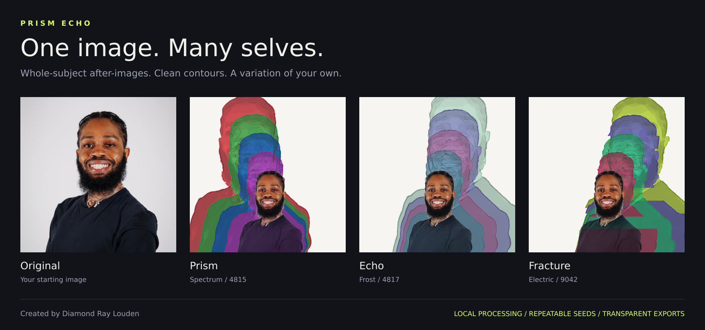

# Prism Echo

**One image. Many selves.**

A browser-local portrait studio that builds progressively larger, color-separated after-images from your photograph. Smooth texture, crisp graphic edges, repeatable variations, and transparent layers you can take into another design tool.



Created by **Diamond Ray Louden**. The showcase above is actual engine output.

## Try it locally

Use Node.js **22 or newer** (Node 24 recommended). No package installation, API keys, or backend setup.

```sh
cd prism-echo
npm run dev
```

Open **http://localhost:4173**. Edit `src/` or `public/` and refresh after the terminal reports a rebuild. To use another port: `npm run dev -- --port 3000`.

The ZIP includes a ready-built `dist/` folder, but ES modules and workers need an HTTP server; opening `index.html` directly from disk is not supported.

## What you can make

- **Whole-subject echoes:** 1–6 copies grow around a shared lower anchor behind the original foreground.
- **Clean print-inspired forms:** Smoothness removes fine texture; Graphic definition firms the edges and tone planes without changing the foreground photograph.
- **Your own variation:** Three compositions, four palettes, separation, fragmentation, and deterministic seeds.
- **Subject control:** Automatic simple-background removal, existing transparency, an oval mask, or a full-image effect. Refine the mask with Keep and Erase brushes.
- **Face protection:** Move the protected region by clicking, or use arrow keys and Enter. Hold Shift for bigger moves.
- **Portable exports:** Finished PNG, aligned transparent after-images, and aligned foreground subject. Export at 1024, 2048, or 3072 pixels on the longest side.
- **Repeatable recipes:** Save settings, seed, export size, and the actual mask in JSON. Keep the original photo alongside the recipe.

Uploads stay in browser memory. There are no remote image-processing calls, analytics, runtime CDNs, or image storage. A worker handles rendering in supported browsers; a main-thread fallback is available.

## A good first result

1. Upload a simple-background portrait or transparent cutout. The bundled demo is ready when the app opens.
2. Start with **Prism / Spectrum**, **Smoothness 82**, and **Graphic definition 82**.
3. Refine the mask if the background appears in the echoes. Set face focus on the foreground face.
4. Adjust growth and separation, then try **New variation**. The other controls stay in place.
5. Download the finished image, or export both transparent layers at the same size and settings.

Place the after-images **over** the aligned foreground layer, then add the selected background to reconstruct the finished composition. Don't place them behind the subject: the renderer intentionally allows some controlled overlap.

## Push it to GitHub

[The publishing guide](docs/PUBLISHING.md) has exact commands for creating a repository, pushing the code, and enabling the included GitHub Pages workflow. It also covers replacing the sample portrait and adding a demo link to the repository.

## Commands

| Command | Result |
| --- | --- |
| `npm run dev` | Local server and source watcher |
| `npm run check` | Syntax, imports, UI references, and demo checks |
| `npm test` | Engine, mask, recipe, worker, and build tests |
| `npm run build` | Static output in `dist/` |
| `npm run verify` | All checks, tests, and build |
| `npm run release` | Source + built app ZIP and SHA-256 in `releases/` |

GitHub Actions runs verification on pushes and pull requests. The Pages workflow verifies before deploying `main`.

## Project map

| Path | Purpose |
| --- | --- |
| `src/engine.mjs` | Browser-independent pixel engine |
| `src/app.mjs` | Canvas, uploads, UI, masks, and downloads |
| `src/render-worker.mjs`, `src/renderer.mjs` | Background rendering and fallback |
| `src/recipe.mjs` | Recipe validation, presets, and mask scaling |
| `public/` | HTML, favicon, configurable demo, and source image |
| `scripts/` | Dependency-free dev server, checks, build, and ZIP release |
| `tests/` | Synthetic image fixtures and behavioral tests |
| `docs/` | Engine explanation, publishing, and browser QA checklist |

See [how the renderer works](docs/ENGINE.md) for the processing pipeline and an engine API example.

## Practical limits

Automatic isolation uses border colors and connected flood fill. It isn't semantic AI segmentation; complex backgrounds may need a transparent cutout or manual cleanup. Face focus is estimated from mask bounds, not face recognition.

Preview resolution is capped at 760 pixels. Export resolution changes edge sampling and smoothing, so preview and export aren't pixel-identical. Reproduce an export with the same source image, crop, recipe, mask, and export size. Recipes identify a source by filename and dimensions; they do not verify its content. Image decoding can vary slightly across browsers.

Large PNG exports use substantial memory. Use 1024 or 2048 pixels on smaller devices. The artwork has a screen-print-inspired appearance; PNG exports are RGB raster artwork, not spot-color separations or production-ready printing files.

## License and assets

All rights reserved; no open-source license has been selected. See [LICENSE](LICENSE). Public source visibility does not grant reuse permission. The bundled portrait and derived showcase images are separate assets and are not licensed for reuse.

The bundled portrait has EXIF/XMP/IPTC metadata removed. User-uploaded originals are never modified or persisted by the studio.
